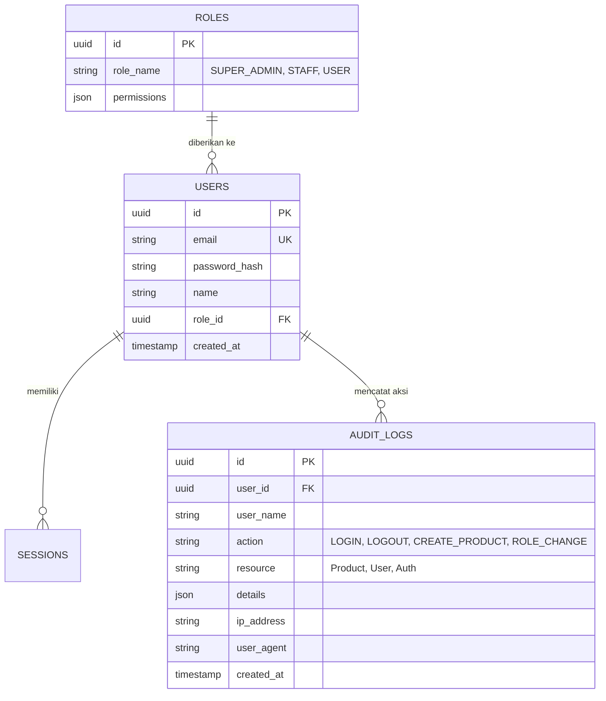

# 📋 Master Plan & Jobdesk Tim: Triple AAA (Setia Tani)

Dokumen ini adalah indeks utama implementasi **Triple AAA (Authentication, Authorization, Accounting)** untuk proyek website **Setia Tani**.

Jobdesk pengerjaan telah dipisahkan menjadi file mandiri per anggota tim agar mudah dibagikan dan dikerjakan secara paralel:

---

## 📂 Dokumen Jobdesk Per Anggota Tim

Silakan klik tautan dokumen sesuai tugas masing-masing:

| No | Anggota | Peran / Spesialisasi | Fokus Pilar | File Jobdesk Mandiri | Branch Git |
| :-: | :--- | :--- | :--- | :--- | :--- |
| 1 | **Orang 1** | Backend & Authentication Engineer | **Authentication** *(Autentikasi)* | 📄 [ORANG_1_AUTHENTICATION.md](file:///c:/Users/m4ulanash/Documents/setia_tani/jobdesk/ORANG_1_AUTHENTICATION.md) | `feat/authentication-core` |
| 2 | **Orang 2** | Security & Authorization Engineer | **Authorization** *(Autorisasi / RBAC)* | 📄 [ORANG_2_AUTHORIZATION.md](file:///c:/Users/m4ulanash/Documents/setia_tani/jobdesk/ORANG_2_AUTHORIZATION.md) | `feat/rbac-authorization` |
| 3 | **Orang 3** | Audit & Accounting Specialist | **Accounting** *(Akunting / Audit Trail)* | 📄 [ORANG_3_ACCOUNTING.md](file:///c:/Users/m4ulanash/Documents/setia_tani/jobdesk/ORANG_3_ACCOUNTING.md) | `feat/audit-accounting` |
| 4 | **Orang 4** | Frontend UI/UX & Integration Specialist | **Antarmuka & Dashboard** | 📄 [ORANG_4_FRONTEND_UI.md](file:///c:/Users/m4ulanash/Documents/setia_tani/jobdesk/ORANG_4_FRONTEND_UI.md) | `feat/ui-auth-dashboard` |

---

## 🗄️ Relasi Skema Database Terintegrasi

Berikut gambaran integrasi data antara pilar Auth (Orang 1), RBAC (Orang 2), dan Audit Log (Orang 3):

---

## 🔄 Alur Kerja Tim (Workflow)

1. **Sprint 1 (Kesepakatan Awal)**:
   - Orang 1 & 2 menyepakati nama tabel, kolom, dan enum tipe data (`types/auth.ts`).
   - Orang 4 mulai membuat mock-up form Login/Register tanpa menunggu backend selesai.
2. **Sprint 2 (Pengerjaan Inti)**:
   - Orang 1 menyelesaikan hash password & login session.
   - Orang 2 memasang middleware proteksi rute (`middleware.ts`).
   - Orang 3 membuat fungsi pencatat `createAuditLog()`.
3. **Sprint 3 (Integrasi)**:
   - Helper audit milik Orang 3 dipasang di auth (Orang 1) dan role change (Orang 2).
   - Orang 4 menyambungkan form UI ke Server Actions Orang 1, 2, dan 3.
4. **Sprint 4 (Testing & Uji Coba Keamanan)**:
   - Uji coba skenario login gagal, hak akses ilegal (user biasa coba buka `/admin`), dan cek apakah semua jejak aksi terekam rapi di halaman Audit Trail Viewer.
